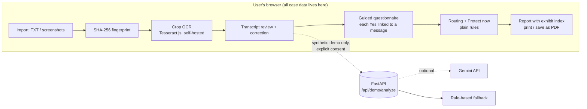

# HerNest

**Turn scattered screenshots and chats about online abuse into an organised, source-linked case file, and show the person where to report it, without sending her evidence to a server.**

Built for **recHERsion 2026 (Problem Statement 2: Women's Safety)** · ACM-W, NITK Surathkal · Engineer NITK 2K26

| | |
|---|---|
| Live demo | `TODO(team): https://...` |
| Demo video | `TODO(team): https://...` |
| Slides | `TODO(team): https://...` |
| Team | `TODO(team): names, college` |
| Status | Hackathon prototype. Not a legal service, an emergency service, or certified evidence software. |

---

## 1. The problem

Someone being threatened, stalked, impersonated or blackmailed online usually has the proof, but it is a pile of screenshots in a gallery. When she decides to report, three things go wrong:

1. **The evidence is hard to present.** Screenshots have no order, no source and no context, so a complaint is easy to dismiss.
2. **She does not know where to go.** Platform report, cybercrime portal, 1930 helpline, 181, 112, StopNCII: each is for a different situation.
3. **Handing the material to a tool is itself a risk.** Most "AI assistant" designs would upload the most sensitive messages of her life to a third party.

**Target user:** a college student in India dealing with online threats, image misuse or impersonation, who has not yet reported and is not sure what counts as evidence.

## 2. What HerNest does

```
Import ──► Review ──► Facts ──► Plan ──► Export
```

1. **Import.** Upload a chat export (`.txt`) or add screenshots. Every file gets a SHA-256 fingerprint in the browser.
2. **Review.** For screenshots, draw a box around one message, mark it *Me* or *Other person*, run OCR on that crop only, then correct the text. Nothing moves on until every message is marked reviewed.
3. **Facts.** Answer six plain questions ("Did anyone threaten to share private images?"). A *Yes* is only accepted if it is linked to a specific message. The user confirms each fact before it is used anywhere.
4. **Plan.** Reporting routes appear based on confirmed facts and one explicit "immediate danger" checkbox. A "Protect now" checklist is available from the first screen.
5. **Export.** Print or save a report where each fact cites its source. Screenshot-derived text cites an exhibit number (A-1, A-2, ...) with the crop, its own hash, and the original file's hash.

### Features

- **Crop-first OCR**, fully in the browser (Tesseract.js, English / Hindi / Telugu). Each result keeps its pixel box so the source can be highlighted. New crops are appended to the transcript, never replacing it.
- **Experimental bubble detector** that proposes boxes by colour and side. It is a helper; every box must be checked.
- **Exhibit pack.** Each crop is stored as a PNG with its own SHA-256, an exhibit number, the source file hash, and an evidence-strength label (chat export / screenshot crop / typed note). Cropped exhibits are attached by default. Full screenshots are opt-in because they can show other chats and names.
- **Refusal marker and timeline.** The user marks the message where she told them to stop. The timeline counts reviewed messages from the other person after that point. The report states it as a sequence, not a legal conclusion.
- **Evidence-linked questionnaire.** No keyword guessing on real evidence. The user answers; the app only records what she can point to.
- **Reporting routes** chosen by confirmed facts (table in section 6).
- **Protect now** checklist (preserve evidence, don't pay under pressure, secure accounts, don't forward images of minors).
- **Quick exit.** Two presses of `Esc` within 3 seconds, or the button with confirmation. It clears the in-memory case and shows a neutral screen. It cannot erase browser history, downloads, screenshots or backups, and the UI says so.
- **English / Hindi / Telugu** for the core screens. Hindi and Telugu strings are machine-drafted and **not yet reviewed by native speakers**.
- **Optional AI demo** that runs on synthetic conversations only (section 5).

## 3. Architecture



Solid lines stay on the device. Dotted lines are the only paths that leave it, and only for fictional text.

**There is no database and no account system.** The case lives in browser memory until the page is closed or refreshed. Only the light/dark theme is saved to `localStorage`.

### Repository layout

```
Hernest/
├── frontend/                  React + Vite
│   ├── src/
│   │   ├── main.jsx           app shell and step flow
│   │   ├── components/        CropOcrTool, GuidedQuestionnaire, EvidenceTimeline,
│   │   │                      ProtectNow, HomePage, ThemeButton
│   │   └── lib/               plain functions, unit-tested:
│   │       chatParser, bubbleDetection, evidenceState, exhibits, timeline,
│   │       questionnaire, routing, protectNow, redaction, fileIntegrity, i18n
│   ├── tests/                 node:test suites for everything in lib/
│   ├── scripts/vendor-ocr-assets.mjs   copies pinned OCR files into public/ocr
│   └── public/                assets, samples, ocr (generated by postinstall)
├── backend/                   FastAPI, optional, synthetic demo only
│   ├── app/main.py
│   └── tests/test_api.py
└── docs/                      evaluation plan, usability script,
                               synthetic fact cases, OCR sample images + ground truth
```

### Stack

| Area | Choice | Why |
|---|---|---|
| UI | React 18, Vite 6, lucide-react | Small, static build; no router needed for a linear flow |
| OCR | tesseract.js 5.1.1 + core + `eng`/`hin`/`tel` data, pinned and self-hosted | Runs offline after first load; no third-party request at OCR time |
| Hashing | Web Crypto (`crypto.subtle`) | Built in; needs HTTPS or localhost |
| Report | Browser print / save-as-PDF | Correct text shaping for Hindi and Telugu without a PDF library |
| Backend | FastAPI, httpx, pydantic | Thin proxy that holds the API key and validates responses |
| Tests | `node --test`, pytest | No extra test framework to install |

## 4. Privacy model

What happens to what the user brings in:

| Data | Leaves the browser? | Notes |
|---|---|---|
| Screenshots and chat files | No | Hashed, cropped and OCR'd locally |
| OCR text and edits | No | Memory only |
| Confirmed facts, exhibits | No | Memory only |
| Exported report | Only if the user shares the file | She chooses what to include |
| Synthetic demo transcript | Yes, to our backend, then optionally to Gemini | Only after the sample is loaded **and** the user ticks the synthetic-data box |

**Check it yourself:** open DevTools → Network, clear it, import a file, crop and run OCR. You should see requests for `/ocr/worker.min.js`, `/ocr/core/*` and `/ocr/lang/*.traineddata.gz`, and nothing carrying her files. `/api/demo/analyze` is called only in demo mode.

**Honest limits**

- Phone and email masking is a basic pattern match. It does not find names, handles, addresses or faces. Review every export.
- A SHA-256 fingerprint shows a file has not changed since it was added here. **It does not prove a screenshot is genuine or when it was taken.** Prefer a chat export over a screenshot when the app offers both; the report labels which is which.
- Quick exit does not remove traces outside the app.
- The Hindi and Telugu text has not been reviewed by native speakers.

## 5. Where AI is used (and where it isn't)

Real evidence never goes to an AI service. Google's terms for unpaid Gemini API use say submitted content may be used to improve their products and advise against sending sensitive or personal information, and redaction cannot guarantee the remaining text is harmless. So:

- **Real-case path:** OCR, review, questionnaire, routing and export are deterministic and local. The app works with the backend switched off.
- **Demo path:** `/api/demo/analyze` accepts only requests marked `synthetic_demo`, capped at 12,000 characters. With a key it asks Gemini for structured suggestions; on any failure, or with no key, it returns conservative rule-based suggestions. The response says which engine answered.
- **Model output is a suggestion.** It is validated against a schema, matched back to messages by quote, and stays unconfirmed until the user ticks it. It never picks a legal provision.
- The demo is not meant to be a public consumer feature. Google's current API terms describe the API as for professional or business use, so check them before changing that.

## 6. Reporting routes

Chosen by confirmed facts, not by guessing. Re-check every link and number against the official site before relying on it; they change.

| Route | Shown when | Source |
|---|---|---|
| National Cyber Crime Reporting Portal | Always | cybercrime.gov.in |
| Report on the platform | Always (link depends on the platform selected) | Platform help centres |
| StopNCII | Confirmed *image shared without consent* | stopncii.org (check eligibility; adults only) |
| 1930 (financial cyber fraud) | Confirmed *possible financial fraud* | cybercrime.gov.in |
| Women's Helpline 181 | Confirmed threat, stalking, image misuse, coercion or impersonation | wcd.gov.in |
| 112 (emergency) | Only if the user ticks *immediate physical danger* | 112.gov.in |

Legal sections are **deliberately not assigned**. Which provision fits depends on facts and elements a tool cannot judge; that is for the police or a lawyer.

## 7. Running it

**Requirements:** Node 18+ (we used the current LTS), Python 3.12 for the optional backend.

### Frontend

```powershell
cd frontend
npm install        # also copies pinned OCR files into public/ocr
npm test
npm run dev        # http://127.0.0.1:5173
```

If `postinstall` reports missing OCR files, fix the install; there is intentionally no CDN fallback.

### Backend (optional)

```powershell
cd backend
py -m venv .venv
.\.venv\Scripts\python.exe -m pip install -r requirements.txt
copy .env.example .env      # then load the variables before starting
.\.venv\Scripts\python.exe -m uvicorn app.main:app --reload --port 8000
```

Check `http://127.0.0.1:8000/health` (shows whether a key is set and which model), then `/docs`.

| Variable | Where | Purpose |
|---|---|---|
| `GEMINI_API_KEY` | backend | Optional. Empty means rule-based suggestions only. Synthetic data only. |
| `GEMINI_MODEL` | backend | Model id. Confirm it against Google's current model list; a wrong id falls back to rules. |
| `RATE_LIMIT_MAX_REQUESTS`, `RATE_LIMIT_WINDOW_SECONDS` | backend | Default 5 per 60 s, per process |
| `ALLOWED_ORIGINS` | backend | Exact frontend origin(s), comma-separated, no trailing slash |
| `VITE_API_BASE_URL` | frontend, **at build time** | Backend URL. Defaults to localhost, so set it for any deployed build. |

### Deploying

- **Frontend:** any static host. Root `frontend`, build `npm run build`, output `dist`. The build includes about 43 MB of OCR files; check your host's per-file size limit.
- **Backend:** any host that runs Python. Start with `uvicorn app.main:app --host 0.0.0.0 --port $PORT`.
- Behind a proxy the client address may be the proxy's, in which case the per-process rate limit is shared by every visitor. Raise the limit or configure forwarded headers. A shared or edge rate limiter is needed before any public launch.
- Free backend tiers sleep when idle. The app still works without the backend; only the AI demo is affected.
- OCR needs HTTPS (or localhost) and serves `.wasm` and `.gz` files. Smoke-test OCR on the deployed URL, on desktop and phone.

## 8. Evaluation

### 8.1 Against the hackathon criteria

| Criterion | Weight | How HerNest addresses it | Where to check | Known gaps |
|---|---:|---|---|---|
| Problem relevance and understanding | 15% | One specific user and three concrete failures (unusable evidence, unclear routes, privacy risk). Routes follow the official split between 1930, the portal and 112. | Sections 1 and 6 | No user interviews yet |
| Innovation and originality | 15% | Every fact needs a source message. Screenshot text becomes a numbered exhibit with its own hash and strength label. Refusal-based timeline. Local-first OCR. AI deliberately kept off real evidence. | `lib/exhibits.js`, `lib/timeline.js`, `lib/questionnaire.js` | Evidence organisers exist already (section 10); the difference is in the combination, not any one part |
| Technical implementation | 20% | Logic split into small tested modules. Pinned, self-hosted OCR. Backend validates model output, bounds input, rate-limits, times out, keeps the key in a header, and falls back safely. | `frontend/src/lib`, `frontend/tests`, `backend/app/main.py` | `main.jsx` is still large. No component or browser tests. The rate limiter is per process. |
| Working MVP and demonstration | 25% | See 8.2 | Section 8.3 | Live demo recording and browser smoke test pending |
| Feasibility and potential impact | 15% | Free stack, static hosting, no database, works offline after first load. Growth path: state-wise resource directory, tie-ups with college committees and NGOs. | Sections 3 and 7 | Resource data and phone numbers need periodic verification. Hindi and Telugu need review. |
| User experience and accessibility | 10% | One linear flow, one main action per step, light and dark themes, quick exit, three languages, plain-language questions. | `components/`, `lib/i18n.js` | No accessibility audit run. Indian-script fonts rely on system fonts. |

### 8.2 Working MVP breakdown (25 marks)

| Component | Marks | What demonstrates it | Status |
|---|---:|---|---|
| Core functionality | 10 | Crop OCR, correction, append, questionnaire with source links, routing, exhibit pack | Implemented; unit-tested |
| End-to-end workflow | 5 | Import → review → facts → plan → export on one case | Implemented; **needs recorded run on the deployed URL** |
| Prototype completeness and integration | 5 | Frontend modules, optional backend, fallback path, report using every earlier step | Implemented |
| Demonstration and validation | 5 | Scenario-based demo plus the checks in 8.3 | Demo video pending; validation partly run |

### 8.3 What we have actually checked

Dates are 2026-10-25. Anything not run is marked as such.

| Check | Scope | Result | Notes |
|---|---|---|---|
| Frontend unit tests | 25 tests | 25 pass | `npm test` |
| Backend tests | 10 tests | 10 pass | `python -m pytest -q` |
| Production build | `vite build` | Pass | |
| Rule fallback on synthetic cases | 20 hand-written cases | 20 of 20 exact category match | A development suite: we wrote both the cases and the rules. Not evidence of general accuracy. |
| OCR crop accuracy | 10 synthetic screenshots in `docs/ocr-eval-samples` | **Not run** | Fill the table in `docs/evaluation-plan.md` |
| Gemini on the same 20 cases | 20 cases | **Not run** | Only worth reporting if the engine field says `gemini` |
| Student usability test | 3–5 people | **Not run** | Script in `docs/usability-test-script.md` |
| Accessibility audit (axe / Lighthouse) | Main screens | **Not run** | |
| Native-speaker review | Hindi, Telugu | **Not done** | |

### 8.4 Rulebook checklist

- [x] Problem statement 2 (Women's Safety), team of 2–3, women-only
- [x] Third-party libraries, data and tools acknowledged (section 11)
- [ ] GitHub repository link submitted, commit history accessible
- [ ] Presentation submitted
- [ ] Demo video submitted
- [ ] Final commit made and deployed from that commit **before 9:00 PM IST, 25 Oct 2026**. No commits after the deadline, including small fixes.

## 9. Design decisions

- **Crop first, not whole-image OCR.** Chat screenshots have bubbles on both sides, coloured backgrounds and timestamps. In an informal check on synthetic dark-mode screenshots, whole-image OCR skipped right-aligned bubbles entirely and merged columns in a notice-style layout. Cropping one message gives better text, a known speaker, and an exact source region. This was an informal observation, not part of the table above.
- **Never run the chat-export parser on OCR text.** A line like "pay me 6:10 PM" gets split at the colon into a wrong sender. OCR results are built directly from the crop.
- **The questionnaire replaced keyword hints** for real evidence. Hints only matched wording from our own sample.
- **No automatic legal sections.** A tag does not establish the elements of an offence, and a wrong section in a complaint can mislead.
- **Routing is a table, not a model.** The same confirmed facts always produce the same routes, and each route can be traced to a rule and an official source.
- **Print-to-PDF over a PDF library.** Most JavaScript PDF libraries do not shape Indic scripts reliably, and we did not want to ship a report that garbles Hindi or Telugu.
- **No database.** It removes a class of privacy and deployment problems. The cost is that a refresh loses the case; we accept that for now and say so.

## 10. Related work

Evidence-collection and harassment-documentation tools already exist, for example DocuSAFE (NNEDV, no longer maintained), WitnessApp, Smashboard, and the Mindful browser-extension prototype from Harvard's Applied Social Media Lab. There is also academic work on screenshot authenticity (Unmochon, CHI 2021). We have **not tested** these; this list comes from public descriptions and should be checked before it is quoted anywhere.

## 11. Third-party components

React, Vite, lucide-react, tesseract.js and tesseract.js-core 5.1.1, `@tesseract.js-data/eng|hin|tel` 1.0.0, FastAPI, httpx, pydantic, pytest. Optional: Google Gemini API (synthetic demo text only). Check each project's licence before redistributing, in particular the OCR language data. All sample conversations and screenshots in `docs/` and `frontend/public/samples` are fictional.

`TODO(team): state how AI assistants were used, if at all (for example drafting and code review), and confirm the team understands and has tested every part of the submitted code.`


## Licence

