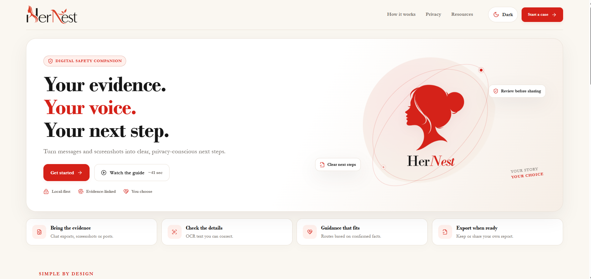
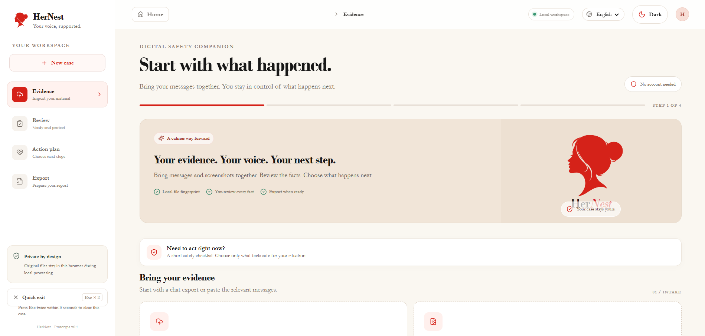
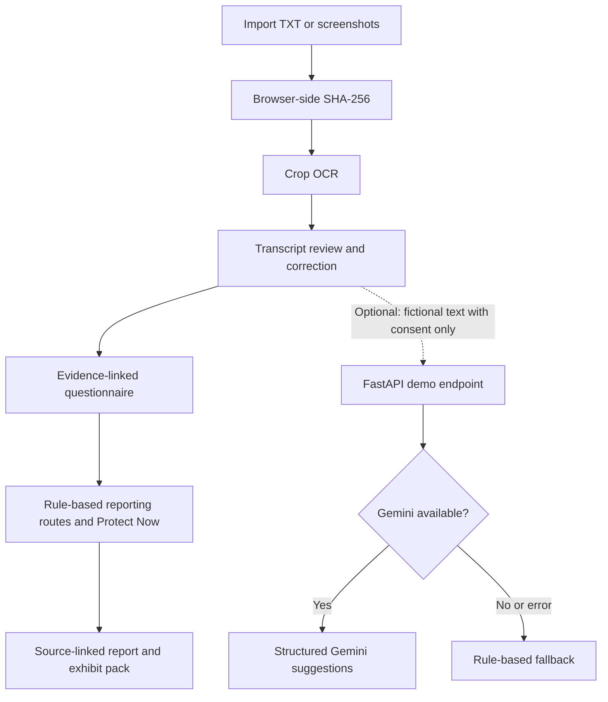

# HerNest
### Your evidence. Your voice. Your next step.

**HerNest is a privacy-conscious digital safety companion that turns scattered chats and screenshots about online abuse into an organised, source-linked case file and guides people toward relevant reporting channels.**

Built for **recHERsion 2026 - Problem Statement 2: Women’s Safety**, organised by ACM-W, NITK Surathkal as part of Engineer NITK 2K26.

> **Core principle:** Real case evidence stays in the browser. The optional AI demo is restricted to fictional, synthetic conversations.

<p align="center">
  
  
</p>

## Demo

- **Live application:**  ***https://her-nest-chi.vercel.app/***
- **Backend health:**  ***https://hernest-ojtr.onrender.com/health***
- **Demo walkthrough (41 seconds):**  ***[ HerNest Demo ](frontend/public/assets/hernest-walkthrough.mp4)***
- **Team:** `LEO`

The walkthrough video is included in the repository at `frontend/public/assets/hernest-walkthrough.mp4`.

## The problem

People experiencing online threats, stalking, impersonation, coercion or image misuse may have evidence spread across screenshots and chat exports. Organising it into a clear report can be difficult, reporting routes can be confusing, and sending sensitive conversations to an AI service can introduce additional privacy risks.

HerNest brings evidence review, source-linked facts, a structured timeline and practical next steps into one guided workflow.

## How it works

```text
Import evidence → Review and correct → Confirm facts → Get an action plan → Export a report
```

1. **Import:** Add a chat export (`.txt`) or screenshots. Files receive SHA-256 fingerprints in the browser.
2. **Review:** Crop individual messages from screenshots, run OCR on the selected crop, identify the speaker and correct the extracted text.
3. **Confirm facts:** Answer guided questions and link each confirmed answer to a specific reviewed message.
4. **Plan:** View reporting routes based on confirmed information, alongside the **Protect Now** safety checklist.
5. **Export:** Print or save a source-linked report with an exhibit index, crop images, hashes and a refusal timeline when applicable.

## Key features

- **Crop-first OCR:** Uses Tesseract.js for English, Hindi and Telugu. OCR runs in the browser, and extracted text can be corrected before use.
- **Screenshot evidence exhibits:** Creates numbered exhibits (`A-1`, `A-2`, …) with a crop image, crop hash, original file hash, pixel region, capture method and evidence-strength label.
- **Source-linked reporting:** Report facts can point back to the reviewed message or numbered screenshot exhibit supporting them.
- **Refusal marker and timeline:** Mark the message where contact was refused. The timeline counts reviewed messages from the other person after that point and presents the sequence neutrally, without making a legal conclusion.
- **Guided questionnaire:** Facts are confirmed by the user and linked to source messages rather than inferred from keyword matches on real evidence.
- **Contextual reporting routes:** Routes are shown according to confirmed information and the user's selection of immediate physical danger.
- **Protect Now:** Practical guidance for preserving evidence, securing accounts, avoiding pressured payments and not forwarding intimate images-especially images involving minors.
- **Quick exit:** A two-press `Esc` shortcut or the on-screen action clears the in-memory case and shows a neutral screen. It cannot erase browser history, downloads or external copies.
- **English, Hindi and Telugu interface:** Core screens support all three languages.
- **Optional synthetic-data AI demo:** A FastAPI endpoint can request structured suggestions from Gemini for explicitly submitted fictional text. If the provider is unavailable or no key is configured, a rule-based fallback responds instead.
- **Light and dark themes:** Theme preference is stored locally.

## Privacy and safety by design

| Information | Handling |
|---|---|
| Screenshots and chat files | Processed locally in the browser |
| OCR text and corrections | Kept in browser memory |
| Confirmed facts and exhibits | Kept in browser memory |
| Exported report | Saved or shared only by the user |
| Synthetic demo transcript | Sent to the backend only in the optional demo flow, after explicit consent; may be sent to Gemini if configured |

HerNest has **no account system and no case database**. A refresh or closing the page can lose the in-memory case, so export the report when needed.

A SHA-256 fingerprint helps show whether a file has changed since it was fingerprinted. **It does not prove that a screenshot is genuine or establish when it was taken.** Phone and email masking is pattern-based and may miss names, handles, addresses or faces; review the report before sharing it.

HerNest is a hackathon prototype, not a legal service, emergency service or certified evidence-management system. It does not decide whether an offence occurred or assign legal provisions. If there is immediate danger in India, call **112**.

## Architecture



The main evidence workflow runs locally. The backend is optional and used only for the synthetic AI demonstration.

## Technology stack

| Layer | Technologies |
|---|---|
| Frontend | React 18, Vite 6, JavaScript, lucide-react |
| OCR | Tesseract.js 5.1.1, Tesseract.js Core and English/Hindi/Telugu language data |
| File integrity | Browser Web Crypto API, SHA-256 |
| Report | Browser print / Save as PDF |
| Backend | Python, FastAPI, Uvicorn, httpx, Pydantic |
| Optional AI | Google Gemini API, with deterministic rule-based fallback |
| Testing | Node.js built-in test runner, pytest |
| Deployment | Vercel (frontend), Render (optional backend) |

## Repository structure

```text
HerNest/
├── frontend/
│   ├── src/
│   │   ├── components/        # OCR, questionnaire, timeline, safety panel, UI
│   │   ├── lib/               # Evidence, exhibits, routing, integrity, i18n
│   │   └── main.jsx           # Main application flow
│   ├── tests/                 # Frontend unit tests
│   ├── scripts/               # Self-hosted OCR asset setup
│   └── public/
│       └── assets/
│           └── hernest-walkthrough.mp4
├── backend/
│   ├── app/
│   │   └── main.py            # FastAPI application
│   ├── tests/
│   │   └── test_api.py
│   ├── requirements.txt
│   └── .env.example
└── docs/
    ├── evaluation-plan.md
    ├── synthetic-fact-cases.json
    └── ocr-eval-samples/
```

## Getting started

### Prerequisites

- Node.js 18 or newer
- Python 3.12 for the optional backend
- Git

### 1. Clone the repository

```bash
git clone https://github.com/Soquixx/HerNest.git
cd HerNest
```

### 2. Run the frontend

```bash
cd frontend
npm install
npm test
npm run dev
```

Open the local URL printed by Vite, usually `http://localhost:5173`.

The install step also prepares the pinned, self-hosted OCR assets. If the OCR asset setup fails, fix the install before relying on OCR; there is intentionally no CDN fallback.

### 3. Run the optional backend

Open a second terminal from the repository root:

**Windows PowerShell**
```powershell
cd backend
py -3.12 -m venv .venv
.\.venv\Scripts\python.exe -m pip install -r requirements.txt
Copy-Item .env.example .env
.\.venv\Scripts\python.exe -m uvicorn app.main:app --reload --port 8000
```

**macOS / Linux**
```bash
cd backend
python3.12 -m venv .venv
source .venv/bin/activate
pip install -r requirements.txt
cp .env.example .env
uvicorn app.main:app --reload --port 8000
```

The API is available at `http://127.0.0.1:8000`. Open `/health` to view service status and configured model, or `/docs` to explore the API.

### Environment variables

| Variable | Location | Purpose |
|---|---|---|
| `GEMINI_API_KEY` | Backend | Optional Gemini API key; keep it secret and never place it in frontend variables |
| `GEMINI_MODEL` | Backend | Gemini model identifier |
| `ALLOWED_ORIGINS` | Backend | Comma-separated exact frontend origins, without trailing slashes |
| `RATE_LIMIT_MAX_REQUESTS` | Backend | Maximum requests per rate-limit window |
| `RATE_LIMIT_WINDOW_SECONDS` | Backend | Rate-limit window in seconds |
| `VITE_API_BASE_URL` | Frontend build | Backend HTTPS base URL; defaults to localhost |

The AI endpoint is for synthetic demo conversations only. Do not submit real private evidence to the optional AI feature.

## Deployment

### Frontend - Vercel

- **Root directory:** `frontend`
- **Framework preset:** Vite
- **Build command:** `npm run build`
- **Output directory:** `dist`
- **Environment variable:** `VITE_API_BASE_URL = https://hernest-ojtr.onrender.com`

`VITE_API_BASE_URL` is embedded at build time. Redeploy the frontend after changing it.

### Optional backend - Render

- **Root directory:** `backend`
- **Runtime:** Python 3.12
- **Build command:** `pip install -r requirements.txt`
- **Start command:** `uvicorn app.main:app --host 0.0.0.0 --port $PORT`

Configure `GEMINI_API_KEY` as a backend secret and set `ALLOWED_ORIGINS` to the exact deployed Vercel origin. Render's free service may sleep while idle, so the first request can take longer. HerNest's main evidence workflow remains usable without the backend; only the optional AI demo depends on it.

## Evaluation criteria

The following mapping follows the **recHERsion 2026 official evaluation criteria**.

| Criterion | Weight | HerNest implementation |
|---|---:|---|
| Problem Relevance & Understanding | 15% | Focuses on a student facing online abuse who needs to organise evidence, understand reporting options and reduce privacy risks. |
| Innovation & Originality | 15% | Combines crop-level OCR, numbered exhibits, source-linked facts, a refusal timeline and local-first evidence handling in one guided workflow. |
| Technical Implementation | 20% | React/Vite frontend, modular evidence utilities, browser-side hashing and OCR, FastAPI integration, structured AI response validation and rule-based fallback. |
| Working MVP & Demonstration | 25% | Demonstrates import → review → confirmed facts → action plan → source-linked export. Includes an illustrated 41-second walkthrough video. |
| Feasibility & Potential Impact | 15% | Uses a low-cost web stack, requires no account or case database, and keeps the primary evidence workflow client-side. |
| User Experience & Accessibility | 10% | Guided linear flow, light/dark themes, quick exit, plain-language questions and English/Hindi/Telugu interface support. |

### Testing and evaluation results

| Test | Result |
|---|---|
| Frontend unit tests | 25 passed |
| Backend tests | 10 passed |
| Rule-based fallback on curated synthetic cases | 20/20 exact category-set matches |

The 20-case result is from a hand-authored development suite in which the test cases and fallback rules were created for the same expected categories. The OCR sample evaluation, Gemini comparison and browser-level usability/accessibility checks are separate from this result.

## Reporting and support routes

HerNest presents routes based on confirmed facts and user choices:

- **National Cyber Crime Reporting Portal:** https://cybercrime.gov.in/
- **Financial cyber fraud helpline:** 1930, when financial cyber fraud is confirmed.
- **Emergency response:** 112, when the user selects immediate physical danger.
- **Women’s Helpline:** 181, where applicable.
- **StopNCII:** https://stopncii.org/ - eligibility depends on the circumstances and service requirements.
- **Platform reporting:** the relevant platform's own reporting channel.

Routes and eligibility should be interpreted according to the official service guidance. HerNest does not automatically assign legal sections or determine whether a crime has occurred.

## Third-party components and acknowledgements

HerNest uses React, Vite, lucide-react, Tesseract.js and its OCR language data, FastAPI, Uvicorn, httpx, Pydantic, pytest and optionally the Google Gemini API. These components remain subject to their respective licences and terms. Sample conversations and screenshots included with the project are fictional.

## Licence

`All rights reserved until after the hackathon, unless a licence is added by the project team.`

---

<p align="center">
  <strong>HerNest - Your evidence. Your voice. Your next step 🖤.</strong>
</p>
